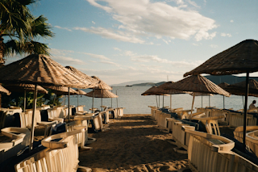
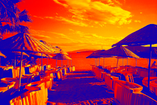
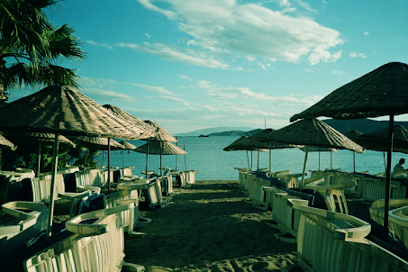

 

# Multimedia Content Production | Portfolio 2026

Portfolio de trabalhos práticos desenvolvidos na unidade curricular de **Multimedia Content Production**, por **Guilherme Faria (A044772)**.

  

  
  
  
  

---

## Índice

| # | Categoria | Trabalho | Software | Acesso |
|:--:|---|---|:--:|:--:|
| 01 | Edição de imagem | Molduras | Photopea | [Ver](#ex1) |
| 02 | Edição fotográfica | Praia — Variações de imagem | Photopea | [Ver](#ex3) |
| 03 | Design tipográfico | Visit Los Angeles | Photopea | [Ver](#ex4) |
| A | Correção de cor | Fases do dia — Noite e amanhecer | Photopea | [Ver](#exA) |
| B | Ilustração digital | Arquitetura Cyber-Noir | Photopea | [Ver](#exB) |
| C | Design editorial | Skillet — Monster | Photopea | [Ver](#exC) |

---

## Galeria de trabalhos

### 01 — Edição e composição de imagem

**Exercício 1 · Molduras**

Trabalho dedicado à edição e composição de imagem, explorando diferentes intensidades de aplicação de uma moldura e a comparação dos resultados.

  

#### Comparação das versões

<table>
  <tr>
    <td width="33.33%" align="center" valign="top">
      
      
<b>01 / 30%</b>

    </td>
    <td width="33.33%" align="center" valign="top">
      
      
<b>02 / 60%</b>

    </td>
    <td width="33.33%" align="center" valign="top">
      
      
<b>03 / 100%</b>

    </td>
  </tr>
</table>

Photopea · Edição de imagem · Comparação de intensidades

<a href="#topo">↑ Voltar ao topo</a>

---

### 02 — Edição fotográfica

**Exercício 3 · Praia**

Sequência de edição sobre a mesma fotografia, desde a imagem original até às versões com diferentes tratamentos cromáticos.

<table>
  <tr>
    <td width="33.33%" align="center" valign="top">
      
      
<b>01 / ORIGINAL</b>

      Imagem de partida
    </td>
    <td width="33.33%" align="center" valign="top">
      
      
<b>02 / VARIAÇÃO</b>

      Tons vermelhos
    </td>
    <td width="33.33%" align="center" valign="top">
      
      
<b>03 / FINAL</b>

      Imagem editada
    </td>
  </tr>
</table>

Photopea · Edição fotográfica · Variações de cor

<a href="#topo">↑ Voltar ao topo</a>

---

### 03 — Design tipográfico

**Exercício 4 · Visit Los Angeles**

Composição tipográfica em que as letras funcionam como máscara para uma fotografia de palmeiras, sobre um fundo em degradê de azul para branco.

  

Photopea · Tipografia · Máscaras de imagem · Composição gráfica

<a href="#topo">↑ Voltar ao topo</a>

---

### 04 — Correção de cor e fases do dia

**Exercício A · Noite e amanhecer**

Adaptação da mesma fotografia de uma paisagem alpina a duas condições de iluminação distintas. As versões exploram alterações de luminosidade, contraste e tonalidade para representar diferentes fases do dia.

<table>
  <tr>
    <td width="33.33%" align="center" valign="top">
      
      
<b>01 / ORIGINAL</b>

      Fotografia de partida
    </td>
    <td width="33.33%" align="center" valign="top">
      
      
<b>02 / NOITE</b>

      Escurecimento e tons azulados
    </td>
    <td width="33.33%" align="center" valign="top">
      
      
<b>03 / AMANHECER</b>

      Coloração verde e ciano
    </td>
  </tr>
</table>

Photopea · Luminosidade · Contraste · Correção cromática

<a href="#topo">↑ Voltar ao topo</a>

---

### 05 — Ilustração digital

**Exercício B · Arquitetura Cyber-Noir**

Transformação de uma fotografia de arquitetura contemporânea numa ilustração digital de inspiração **Cyber-Noir**. A composição explora contrastes fortes, tons frios, contornos escuros e texturas visuais, procurando afastar-se da aparência fotográfica original.

<table>
  <tr>
    <td width="50%" align="center" valign="top">
      
      
<b>01 / ORIGINAL</b>

      Fotografia de arquitetura
    </td>
    <td width="50%" align="center" valign="top">
      
      
<b>02 / ILUSTRAÇÃO</b>

      Interpretação visual Cyber-Noir
    </td>
  </tr>
</table>

Photopea · Tratamento de imagem · Ilustração digital

<a href="#topo">↑ Voltar ao topo</a>

---

### 06 — Design editorial e capas musicais

#### Exercício C · Skillet — *Monster*

Capa de disco inspirada na banda de rock **Skillet**, desenvolvida a partir de uma fotografia de concerto. A composição combina imagem e tipografia, dando destaque ao nome da banda e ao título *Monster*.

<table>
  <tr>
    <td width="50%" align="center" valign="top">
      
      
<b>01 / ORIGINAL</b>

      Fotografia de partida
    </td>
    <td width="50%" align="center" valign="top">
      
      
<b>02 / FINAL</b>

      Composição gráfica
    </td>
  </tr>
</table>

  <b>SKILLET</b> &nbsp;·&nbsp; <i>Monster</i>

Photopea · Composição gráfica · Design de capa musical

<a href="#topo">↑ Voltar ao topo</a>

---

  

  

  Multimedia Content Production | 2.º Ano | 2026
   
  Desenvolvido por GuilhermeFaria-A044772

