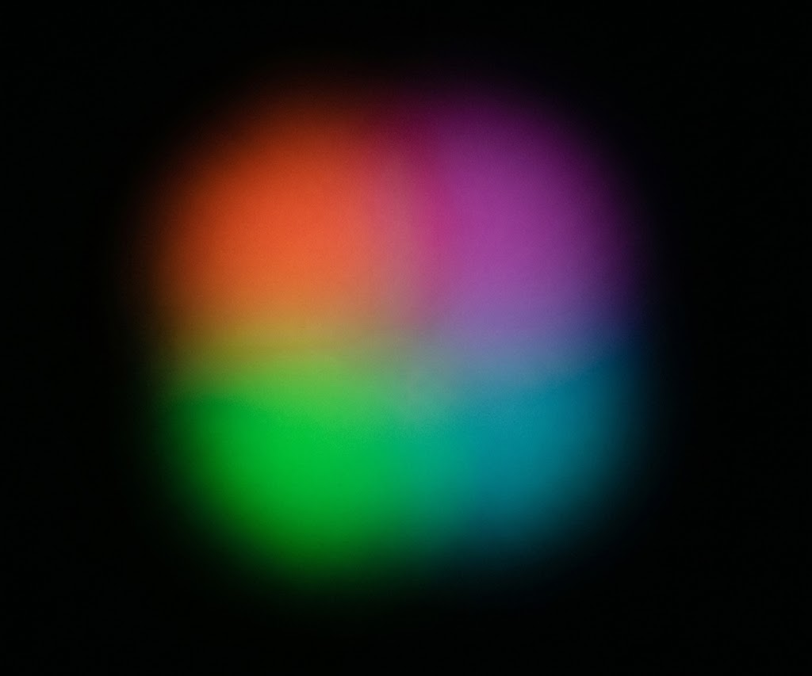
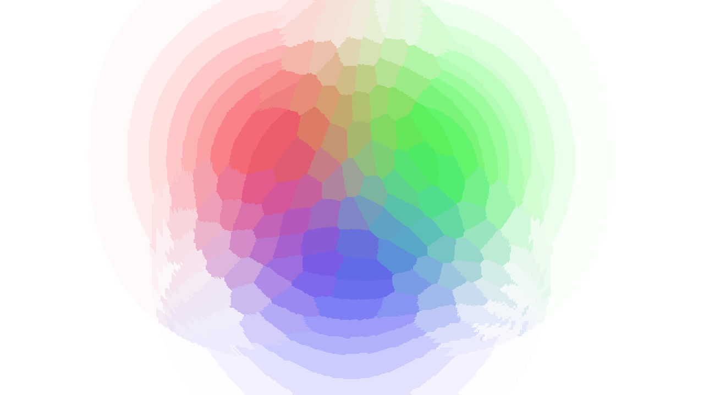
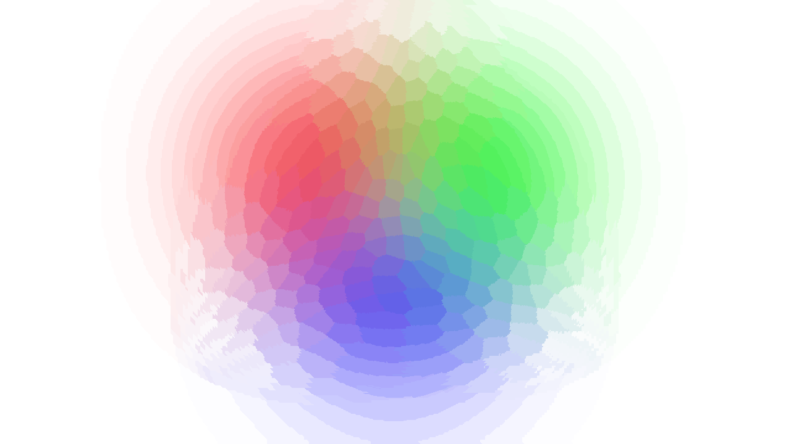
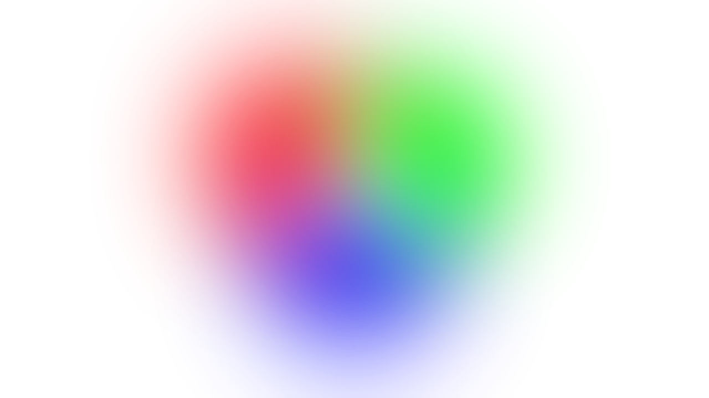

# Multimedia Content Production · Portfolio 2026

Welcome to the multimedia portfolio of **GuilhermeFaria-A044772**, showcasing practical work developed for the Multimedia Content Production course.

  

  
  
  

  

---

## Trabalhos Práticos

### Exercício 1 — Edição de Imagem

<table>
  <tr>
    <td width="55%" align="center" valign="middle">
      
    </td>
    <td width="45%" valign="middle">
      <h3>Exercício 1</h3>
      
Trabalho prático dedicado à edição e composição de imagem, explorando diferentes versões de uma moldura e a sua apresentação visual.

      
<b>Software:</b> Photopea

      
<b>Categoria:</b> Produção Multimédia

      
<a href="#método-de-edição">Explorar o método de edição ↓</a>

    </td>
  </tr>
</table>

<a href="#multimedia-content-production--portfolio-2026">↑ Voltar ao topo</a>

---

## Molduras

Three variations of the exercise, presented side by side to make their visual differences easier to compare.

<table>
  <tr>
    <td width="33.33%" align="center" valign="top">
      
      
<b>30%</b>

      Versão 30
    </td>
    <td width="33.33%" align="center" valign="top">
      
      
<b>60%</b>

      Versão 60
    </td>
    <td width="33.33%" align="center" valign="top">
      
      
<b>100%</b>

      Versão 100
    </td>
  </tr>
</table>

  <i>Selecciona qualquer imagem para a visualizar individualmente.</i>

<a href="#multimedia-content-production--portfolio-2026">↑ Voltar ao topo</a>

  

  <i>Discover more projects, experiments and practical work.</i>

  

  Multimedia Content Production · 2.º Ano · 2026
   
  Developed by GuilhermeFaria-A044772

